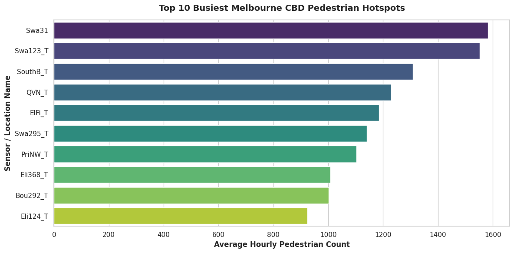

# Melbourne CBD Retail Location Intelligence Analysis

## 📌 Project Overview & Business Case
A commercial brand wants to open a new flagship physical store in the Melbourne Central Business District (CBD). This data analytics project leverages municipal pedestrian sensor records to evaluate foot traffic density across key streets. 

The goal of this analysis is to provide corporate stakeholders with data-driven recommendations on high-traffic areas to maximize storefront visibility, customer engagement, and physical footprints.

---

## 🛠️ Data Infrastructure & Workflow
1. **Data Ingestion:** Sourced real-world municipal foot traffic assets directly from the City of Melbourne Municipal Registry.
2. **Relational Database Management (SQL):** Structured local storage staging tables, cast mismatched data parameters, and built aggregate SQL grouping queries.
3. **Data Visualization:** Built optimized visual layouts to convey analytical conclusions clearly to executive decision-makers.

---

## 📊 Analytical Insights & Dashboard Preview
The analysis successfully calculated the top 10 busiest pedestrian zones within the Melbourne city center grid based on absolute average hourly volume:

### Key Takeaways for Corporate Strategy:
* **Primary Hotspots:** Locations monitored by sensors like `Swa31` and `Swa123_T` maintain the highest overall foot traffic throughput, averaging over 1,500 pedestrians passing hourly.
* **Stable Footfall Channels:** Transition zones around central hubs like `SouthB_T` and `QVN_T` represent incredibly strong alternative retail lanes due to sustained pedestrian pipelines.
* **Strategic Recommendation:** We recommend focusing real estate acquisition pipelines along the primary commercial corridors represented by the top 3 highest-performing sensors to leverage maximum market presence.

---

## 💻 Tech Stack Used
* **Database Language:** SQLite3 (SQL)
* **Programming Environment:** Python 3 (Google Colab / Jupyter Notebooks)
* **Libraries Utilized:** Pandas (Data Transformation), Matplotlib & Seaborn (Data Visualization Architecture)
